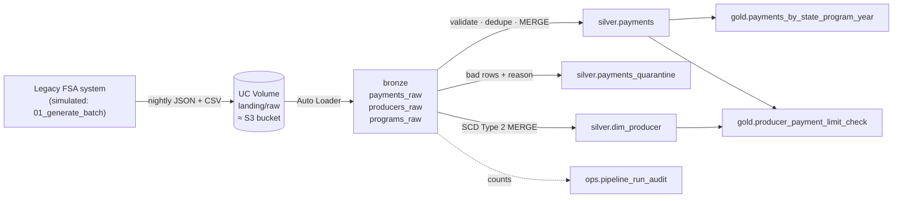

# FSA Payments Lakehouse: a hands-on Databricks project

A small but complete version of the kind of work a Databricks engineer does on a USDA program:
take messy nightly extracts from a legacy Farm Service Agency (FSA) system, land them in cloud
storage, and turn them into governed, trustworthy tables for BI and analytics.

You will build it twice: first **imperatively** (Auto Loader + `foreachBatch` + `MERGE`, so you
understand every moving part), then **declaratively** (Lakeflow Spark Declarative Pipelines),
and compare the two. Every phase ends with questions to answer out loud. That's your interview prep.



## The data

Synthetic, but shaped like the real thing:

| Feed | Format | Arrives | What's in it |
|---|---|---|---|
| `programs/` | CSV | once | ARC-CO, PLC, ELAP, LFP, CRP, ECAP and whether the $125K ARC/PLC payment limit applies |
| `producers/` | CSV | daily | Day 1: full snapshot of 2,000 producers (farmers and farm entities). Later days: about 60 changes (moved state, changed farm type, AGI status flipped) plus new registrations |
| `payments/<date>/` | JSON lines | daily | About 5,000 payments in 2 files |

Defects are built in on purpose: about 2% duplicates (some with a corrected amount), negative amounts,
unknown program codes, invalid state codes, missing and orphan producer IDs, late-arriving payments,
**a corrupt JSON line on day 3**, and **a new column `disbursement_method` from day 4**.

## Repo layout

```
src/fsa_lakehouse/   config.py (all names in one place) · generator.py · transforms.py (business logic) · streaming.py
notebooks/           00_setup → 01_generate_batch → 02_bronze_autoloader → 03_silver → 04_gold → 05_governance.sql → 06_break_it
pipelines/           fsa_declarative_pipeline.py (same pipeline, declarative)
tests/               unit tests for transforms.py: run locally with pytest, no Databricks needed
databricks.yml, resources/   the job and pipeline as code (Declarative Automation Bundle)
.github/workflows/   CI: runs tests on every push
```

Business logic lives in `transforms.py` as pure PySpark functions; notebooks only do I/O.
That split is why it can be unit-tested, and it's a strong thing to say in an interview.

---

## Phase 0 · Set up (about 45 minutes)

1. Sign up for **Databricks Free Edition** (free, serverless, includes Unity Catalog). Search "Databricks Free Edition".
2. Push this folder to a new GitHub repo, for example `github.com/ahsan1201/fsa-lakehouse`. It doubles as a portfolio piece.
3. In Databricks: **Workspace → Create → Git folder**, paste the repo URL.
4. Optional, locally: `pip install -r requirements-dev.txt && pytest -q`. You should see 8 tests pass (needs Java 17).
5. Open `notebooks/00_setup`, attach to **Serverless**, run all.
   * If `CREATE CATALOG` is refused: set `CATALOG = "workspace"` in `src/fsa_lakehouse/config.py` and rerun.
6. Open **Catalog** in the left bar and find your catalog, the five schemas, and the two volumes.

**Say it out loud:** What is the difference between a catalog, a schema, and a volume? Why is a volume governed when an S3 path is not?

## Phase 1 · Land and ingest: bronze (day 1)

1. Run `01_generate_batch` with `batch_day = 1`. Browse the files in the `landing/raw` volume.
2. Run `02_bronze_autoloader`.
3. Run `02` **again** without generating anything new. Note that nothing new is ingested.
4. Generate day 2, run `02`. Only day 2's files are picked up.
5. Look in `ops/checkpoints/schemas/payments`: that's the inferred schema Auto Loader saved.

**What to notice:** `_ingest_file` on every row; all columns are strings; `_rescued_data`.

**Say it out loud:**
* How does Auto Loader know which files it already processed? (checkpoint / RocksDB file state)
* Why `availableNow` instead of a continuously running stream? (cost; nightly SLA; same exactly-once bookkeeping)
* Why keep bronze as strings? (ingestion never fails on a bad value; typing and validation are silver's job)
* Auto Loader vs `COPY INTO`: when would you use each?

## Phase 2 · Clean and conform: silver (days 1–3)

1. Run `03_silver`. Read the three result cells at the bottom: audit counts, quarantine reasons, SCD2 history.
2. Generate **day 3** (contains the corrupt line), run 02 → 03. Find the corrupt record: is it in bronze? Where did it end up in silver, and with which `dq_errors`?
3. Pick one producer with two versions and walk through `effective_from`, `effective_to`, `is_current`.
4. Read `scd2_staged_updates()` in `transforms.py` until you can explain the `merge_key` trick without looking.

**Say it out loud:**
* Why `MERGE` instead of `append`? What makes the pipeline idempotent?
* Why quarantine instead of dropping bad rows? Who looks at the quarantine table?
* Orphan producer IDs are **flagged, not rejected**. Why? (late-arriving dimension: the producer record may arrive tomorrow)
* Late-arriving payments are **tagged, not rejected**. Why is "late" different from "bad"?
* SCD1 vs SCD2: which one fits `payments` and which fits `dim_producer`, and why?
* Known limitation: if two days of producer changes land in one micro-batch, only the latest version survives. How does `sequence_by` in Phase 5 fix this?

## Phase 3 · Serve: gold and Delta internals

1. Run `04_gold`. The second query is the business deliverable: producers over the ARC/PLC limit, or with AGI over $900K.
2. Work through the Delta cells: `DESCRIBE HISTORY` (open `operationMetrics` for a MERGE), `DESCRIBE DETAIL` (numFiles), `OPTIMIZE`, time travel.

**Say it out loud:**
* What is in the `_delta_log`? How does that give you ACID and time travel?
* Liquid clustering vs partitioning + Z-order: why did you pick `program_year, state_code`?
* `OPTIMIZE` vs `VACUUM`. What does `VACUUM` break? (time travel past the retention window)
* Gold is a full recompute here. At 500M rows, what would you do instead?

## Phase 4 · Govern: Unity Catalog

1. Run `05_governance.sql`. Confirm the TIN shows masked, and the row filter returns only VA and IA.
2. Open `silver.dim_producer` in Catalog Explorer → **Lineage** tab. Trace gold back to bronze.

**Say it out loud:** How would you give county offices access to their own state's payments only?
How do column masks and row filters differ from creating views per group? Where do groups come from in an agency (SCIM from Entra ID / Okta)?

## Phase 5 · Orchestrate: Lakeflow Jobs

1. **UI first:** Jobs & Pipelines → Create job. Add 4 notebook tasks (01 → 02 → 03 → 04) with dependencies and a job parameter `batch_day`. Set retries = 1 on bronze and silver.
2. Run it with `batch_day = 4` (schema drift day). Watch the bronze task. Did it restart, or did the retry catch it?
3. Open the run's task graph, durations, and the output of each task.
4. **Then as code:** read `databricks.yml` and `resources/fsa_jobs.yml`. That's the same job, versioned. Optional: install the Databricks CLI, put your workspace URL in `databricks.yml`, then `databricks bundle deploy -t dev`.

**Say it out loud:** Airflow vs Lakeflow Jobs: when would you keep Airflow? (cross-platform DAGs, existing estate; Airflow can trigger Databricks jobs.) Why `max_concurrent_runs: 1`?

## Phase 6 · Rebuild it declaratively

1. `CREATE SCHEMA fsa.sdp;`
2. Jobs & Pipelines → Create → **ETL pipeline**. Source: `pipelines/fsa_declarative_pipeline.py`, catalog `fsa`, schema `sdp`, serverless, configuration `landing_root = /Volumes/fsa/landing/raw`.
3. Run it. Open the **graph**, click `payments_validated`, and look at the expectations metrics (rows dropped per rule).
4. Compare `sdp.dim_producer` with `silver.dim_producer`: `__START_AT` / `__END_AT` vs your `effective_from` / `effective_to`.

**Say it out loud:** What did the declarative version give you for free, and what did you lose?
(Lost: the audit table, the "flag orphans, don't drop" rule, and custom MERGE conditions.) Which would you choose for a migration of 200 legacy pipelines, and why?

## Phase 7 · Break it

Run `06_break_it`: no-op rerun, re-sent file, bad `UPDATE` + `RESTORE`, schema drift, reconciliation, query plan.
For each, write two sentences: what happened, and why.

## Phase 8 · CI/CD (optional, half a day)

Push a change, watch `.github/workflows/ci.yml` run the tests. To enable deploys: add repo secrets
`DATABRICKS_HOST`, `DATABRICKS_TOKEN` and repo variable `ENABLE_DEPLOY = true`.

---

## How to talk about this project

**Be accurate about what this is.** It's a hands-on project you built on Databricks to apply your
Spark and pipeline experience to the platform. Present it that way. Interviewers ask follow-ups
like "how many DBUs did that job use?" or "how did you size the cluster?", and a made-up production
story falls apart in two questions. A real project you can explain in depth holds up.

**The 60-second version:**
> "To get hands-on with the current Databricks stack, I built a medallion pipeline modeled on FSA
> program payments. Nightly JSON and CSV extracts land in a Unity Catalog volume. Auto Loader ingests
> them incrementally into bronze with schema evolution. Silver validates against business rules,
> quarantines bad rows with the reason attached, deduplicates with MERGE so reruns are idempotent,
> and keeps producer history as SCD Type 2. Gold answers questions like which producers exceeded
> the ARC/PLC payment limit. It's orchestrated as a Lakeflow job, governed with column masks on TINs
> and state-level row filters, the business logic is unit-tested in CI, and I rebuilt it as a
> declarative pipeline to compare the two approaches."

Then connect it to what you've done in production: the Talend-to-Airflow migration, Spark transforms,
the MySQL-to-Greenplum performance work. The patterns (incremental loads, idempotency, data-quality
gates, reconciliation counts) are the same ones you used there.

**How it would scale (the "what changes at USDA size?" question):**

| This project | At agency scale |
|---|---|
| UC Volume as landing zone | S3 external location + storage credential (IAM role), with file-notification mode for Auto Loader instead of directory listing |
| One person, `account users` | Groups synced from the agency IdP; jobs `run_as` a service principal; separate dev/test/prod workspaces or catalogs |
| Full gold recompute | Materialized views, or incremental MERGE driven by Change Data Feed |
| 5K rows per day | Watch file sizes and small-file counts, plus shuffle and skew in the Spark UI; liquid clustering on query predicates |
| Audit table | Plus Lakehouse Monitoring / SQL alerts on quarantine rate and `_rescued_data` counts; system tables for cost (DBUs) |
| Manual bundle deploy | CI/CD promoting the same bundle across dev → test → prod |
| Synthetic data | FedRAMP-authorized workspace, PII handling, data-sharing agreements with states |

## Current product names (2026)

Databricks renamed a lot recently. Use the current names in interviews and know the old ones:

* Workflows → **Lakeflow Jobs**
* Delta Live Tables (DLT) → **Lakeflow Spark Declarative Pipelines** (`from pyspark import pipelines as dp`; `import dlt` still works)
* `apply_changes` → `create_auto_cdc_flow`
* Databricks Asset Bundles → **Declarative Automation Bundles** (still often called DABs)

## Troubleshooting

* **`ModuleNotFoundError: fsa_lakehouse`**: open notebooks from inside the Git folder; they add `../src` to the path.
* **Stream fails with an unknown-field or schema-change error**: expected once when a new column appears. The helper restarts it; in a job, the task retry does.
* **Error inside `foreachBatch` about importing `fsa_lakehouse`**: make sure the `cloudpickle.register_pickle_by_value` cell in 03 ran.
* **Start over cleanly:** `DROP CATALOG fsa CASCADE`, then rerun from 00. Checkpoints live in a volume inside the catalog, so they go too.
* **Free Edition says compute quota exceeded**: it resets the next day. Use `n_payments = 1000` to go easier on it.
